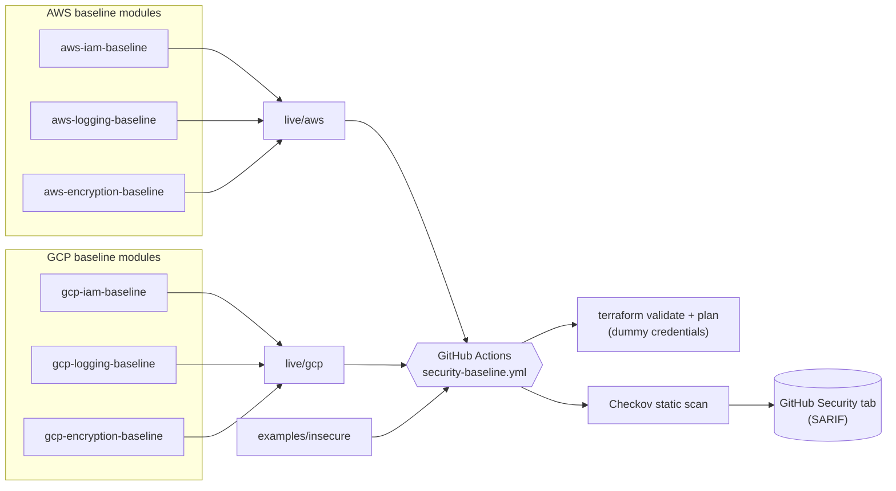

# Multi-Cloud Security Baseline

[](https://github.com/kadeemj/multi-cloud-security-baseline/actions/workflows/security-baseline.yml)

A hardened multi-cloud baseline provisioned as Infrastructure as Code —
IAM least-privilege patterns, logging, and encryption defaults, codified
identically across AWS and GCP — with automated security posture checks
against CIS benchmarks that surface misconfigurations in under 5 minutes per
cloud, entirely without cloud credentials.

## What this demonstrates

- **IAM least-privilege**: custom/scoped roles instead of admin wildcards or
  primitive `roles/owner`, on both clouds.
- **Logging**: multi-region CloudTrail (AWS) and project-wide Cloud Audit
  Logging (GCP), each delivering to a locked-down, versioned bucket.
- **Encryption defaults**: customer-managed KMS keys with rotation, SSE-KMS
  / CMEK on buckets, EBS encryption by default.
- **Automated CIS posture checks**: Checkov scans the IaC on every push,
  gating on a real, curated set of CIS AWS Foundations / GCP Foundation
  Benchmark controls — with a before/after demo (see below) proving it
  actually catches misconfigurations, not just passing by construction.
- **<5 minutes per environment**: not a claim — the [Actions tab](https://github.com/kadeemj/multi-cloud-security-baseline/actions/workflows/security-baseline.yml)
  shows four independently-timed jobs (`terraform`/`checkov` × `aws`/`gcp`),
  each finishing in low single-digit minutes even on a cold cache.

## Architecture



Everything left of the CI node plans with **zero cloud credentials** — see
[Zero-credential design](#zero-credential-design) for why that's possible.

## Repository layout

```
modules/                    reusable, independently-scannable Terraform modules
  aws-iam-baseline/          IAM password policy + least-privilege example role
  aws-logging-baseline/      CloudTrail + locked-down S3 bucket (+ opt-in extras)
  aws-encryption-baseline/   KMS CMK + EBS encryption by default
  gcp-iam-baseline/          Custom least-privilege role (+ opt-in org policy)
  gcp-logging-baseline/      Cloud Audit Logging + locked-down GCS sink bucket
  gcp-encryption-baseline/   KMS key ring/key + CMEK bucket
live/                        deployable root modules composing the above
  aws/  gcp/
examples/insecure/           deliberately broken fixtures — a Checkov demo, never applied
  aws/  gcp/
scripts/                     validate.sh, scan.sh — the same commands CI runs
.github/workflows/           security-baseline.yml
.checkov.yaml                hardened baseline scan config (hard-fail)
.checkov-insecure.yaml       insecure-example scan config (soft-fail, demo only)
```

Every module has its own README with inputs/outputs and a CIS mapping.
`live/` mirrors the Gruntwork `modules/` + `live/` convention — it separates
"the thing you'd actually apply" from `examples/insecure/`, a scan fixture
that's never applied.

## Quickstart (zero credentials)

```sh
git clone https://github.com/kadeemj/multi-cloud-security-baseline.git
cd multi-cloud-security-baseline

# Terraform: init/validate/plan with dummy credentials, no real account needed
./scripts/validate.sh aws
./scripts/validate.sh gcp

# Checkov: scan the hardened baseline (should be clean) and the insecure demo
./scripts/scan.sh aws baseline
./scripts/scan.sh gcp baseline
./scripts/scan.sh aws insecure
./scripts/scan.sh gcp insecure
```

Requires Terraform ≥ 1.5 and Checkov (`pipx install checkov` or
`pip install checkov`) locally; nothing else — no AWS/GCP account, no
exported credentials.

## Zero-credential design

`terraform plan` normally needs real cloud credentials. This repo avoids
that three ways:

1. **No data-source lookups of pre-existing infrastructure.** Every resource
   here is freshly created within the same plan — no `aws_caller_identity`,
   no `data "aws_vpc" "default"`, no `google_project`. Account/project IDs
   are passed as required variables instead (see `ci.tfvars` in each
   `live/<cloud>/`). The one real exception — GCS's CMEK service-agent
   lookup (`data.google_storage_project_service_account`), which genuinely
   needs live credentials even during `plan` — is gated behind
   `resolve_gcs_service_account_via_api = false` by default; see
   `modules/gcp-encryption-baseline/README.md`.
2. **The AWS provider still validates credentials eagerly during `plan`**
   (confirmed empirically against `hashicorp/aws` v6.58 — this is not
   documented behavior you'd guess from the resource graph alone). `live/aws`
   sets `skip_credentials_validation` / `skip_requesting_account_id` on the
   provider, toggled via `skip_credential_validation` (`ci.tfvars` sets it
   `true`; leave `false` for a real apply).
3. **The GCP provider validates credentials client-side (JWT signing)
   before any network call**, so even a placeholder string fails at
   provider init. `scripts/gen-fake-gcp-creds.sh` generates a real,
   syntactically-valid, throwaway self-signed key at runtime — never
   committed, since even a fake committed PEM block tends to trip GitHub
   secret-scanning on a public repo.

Checkov needs no credentials at all — it's a static HCL parser, and never
calls `terraform init`/`plan`.

## CIS control mapping

A curated set of ~10-12 controls per cloud, chosen to work at account/project
level without requiring AWS Organizations or a GCP Organization node.
Checkov's free CLI doesn't group findings by CIS control ID natively (that's
a paid Bridgecrew/Prisma Cloud dashboard feature) — this table is
hand-maintained.

### AWS — CIS AWS Foundations Benchmark v3.0

| Control | Resource | Checkov ID |
|---|---|---|
| 1.9 Password length ≥ 14 | `aws_iam_account_password_policy` | `CKV_AWS_10` |
| 1.10 Password reuse prevention ≥ 24 | `aws_iam_account_password_policy` | `CKV_AWS_13` |
| 1.11 Password expiration ≤ 90 days | `aws_iam_account_password_policy` | `CKV_AWS_9` |
| No wildcard-action IAM policies (illustrative) | `aws_iam_policy.example_readonly_auditor` | `CKV_AWS_49` / `CKV_AWS_63` |
| 3.1 CloudTrail enabled in all regions | `aws_cloudtrail.this` | `CKV_AWS_67` |
| 3.2 CloudTrail log file validation | `aws_cloudtrail.this` | `CKV_AWS_36` |
| 3.3 S3 bucket not publicly accessible | `aws_s3_bucket_public_access_block.logs` | `CKV_AWS_53`-`56`, `CKV2_AWS_6` |
| 3.7 CloudTrail encrypted with CMK (illustrative numbering) | `aws_cloudtrail.this` | `CKV_AWS_35` |
| KMS key rotation enabled | `aws_kms_key.cmk` | `CKV_AWS_7` |
| EBS encryption by default | `aws_ebs_encryption_by_default` | `CKV_AWS_106` |
| 3.4 CloudTrail → CloudWatch Logs *(opt-in)* | `aws_cloudwatch_log_group.cloudtrail` | `CKV2_AWS_10` |
| 3.5 AWS Config enabled *(opt-in, ~$1-3/mo)* | `aws_config_configuration_recorder.this` | `CKV2_AWS_45` / `CKV2_AWS_48` |

### GCP — CIS GCP Foundation Benchmark v2.0

| Control | Resource | Checkov ID |
|---|---|---|
| 1.5-1.8 Avoid primitive roles at project level (illustrative) | `google_project_iam_custom_role` / `_member` | `CKV_GCP_117` |
| 2.1 Cloud Audit Logging for all services/users | `google_project_iam_audit_config.all_services` | `CKV2_GCP_5` |
| 5.1-5.2 Bucket not publicly accessible (illustrative numbering) | `google_storage_bucket` | `CKV_GCP_28` / `CKV_GCP_29` / `CKV_GCP_114` |
| Bucket versioning | `google_storage_bucket` | `CKV_GCP_78` |
| 1.10 KMS key rotation ≤ 90 days | `google_kms_crypto_key.this` | `CKV_GCP_43` |
| KMS keys protected from deletion | `google_kms_crypto_key.this` (`prevent_destroy`) | `CKV_GCP_82` |
| Log-bucket retention via Bucket Lock (illustrative) | `google_storage_bucket.audit_logs` | `CKV2_GCP_4` |
| Restrict service-account key creation *(opt-in, best-effort)* | `google_org_policy_policy` | — |

Where a control is marked "illustrative," the Checkov check is real and
verified (I ran `checkov --list` against the pinned version and confirmed
every ID above actually fires against these resources — see
`examples/insecure/README.md` for the before/after proof), but the exact
CIS section number is approximate; CIS benchmark numbering has shifted across
versions (AWS Foundations v3.0 → v5.0, GCP v2.0 → v4.0) and I'm citing the
version each check was actually verified against, not implying exhaustive
official mapping.

### Excluded by design

- **AWS Organizations / SCPs, GCP Organization-level policy** — this is an
  account/project-level baseline, not an org-level one. `enable_disable_sa_key_creation_org_policy`
  is the one org-policy-adjacent control included, marked best-effort.
- **Root-account MFA enforcement** — requires an out-of-band, MFA-signed API
  call; Terraform can't toggle this.
- **S3 access logging / cross-region replication on the log buckets
  themselves** — would require a second bucket (and, for replication, a
  second region) purely to log/replicate a log bucket. See the inline
  `#checkov:skip` comments in `aws-logging-baseline/main.tf` for the exact
  reasoning.
- **Live posture scanning (e.g. Prowler)** — this repo does static IaC
  scanning only. It tells you the *code* is compliant before you ever apply
  it; it does not scan already-running infrastructure for drift.

## Before / after: Checkov catches real misconfigurations

`examples/insecure/` contains deliberately broken fixtures, scanned in CI
with `--soft-fail` so they demonstrate detection without failing the build:

| | Passed | Failed |
|---|---|---|
| `modules/` + `live/` (hardened baseline) | 100% | **0** |
| `examples/insecure/aws` | 9 | **17** |
| `examples/insecure/gcp` | 3 | **7** |

Representative findings on the insecure fixtures: a public-read S3 ACL with
no encryption/versioning (`CKV_AWS_20`, `CKV_AWS_19`, `CKV_AWS_21`), a
wildcard-action/wildcard-resource IAM policy (`CKV_AWS_49`, `CKV_AWS_356`), a
GCS bucket bound to `allUsers` (`CKV_GCP_28`), and a primitive `roles/owner`
binding at project level (`CKV_GCP_117`). Full breakdown in
`examples/insecure/README.md`. SARIF results from this scan also publish to
the repo's [Security tab](https://github.com/kadeemj/multi-cloud-security-baseline/security/code-scanning).

## CI pipeline

`.github/workflows/security-baseline.yml` runs on every push to `main` and
every pull request, as a 2×2 matrix — `terraform` and `checkov`, each ×
`aws`/`gcp` — so all four jobs run in parallel and each shows its own
duration in the Actions tab. Locally, both `terraform` jobs finish in
single-digit seconds and all four `checkov` jobs finish in 1-2 seconds
(warm cache); expect low single-digit minutes on a cold CI cache
(provider-plugin downloads, pip install) — comfortably under the 5-minute
target per environment. `checkov` needs no Terraform toolchain at all
(it's a pure static parser), so that job runs fully independent of, and in
parallel with, `terraform init`/`validate`/`plan`.

## Deploy this for real

Everything above is plan-only by design. To actually apply it:

**AWS** — `aws sts get-caller-identity --query Account --output text`, copy
`live/aws/ci.tfvars` to a gitignored `terraform.tfvars` with your real
account ID and `skip_credential_validation = false`, then
`terraform init && terraform plan -var-file=terraform.tfvars && terraform apply -var-file=terraform.tfvars`.

**GCP** — `gcloud auth application-default login`, copy `live/gcp/ci.tfvars`
similarly with your real `project_id`/`example_member` and
`resolve_gcs_service_account_via_api = true`, then the same
init/plan/apply sequence.

Cost & teardown notes: AWS KMS ~$1/mo/key with a clean 7-30 day scheduled
deletion on destroy; AWS Config ~$1-3/mo if you enable it
(`enable_aws_config`); **GCP KMS key rings can never be deleted** and the key
resource is `prevent_destroy`-protected — budget for a small indefinite
charge if you apply the GCP side; the GCP audit-log bucket uses **Bucket
Lock**, which is irreversible (see `modules/gcp-logging-baseline/README.md`).
See `live/aws/backend.tf.example` / `live/gcp/backend.tf.example` for
switching from local state to a real remote backend.

## License

MIT — see [LICENSE](LICENSE).
